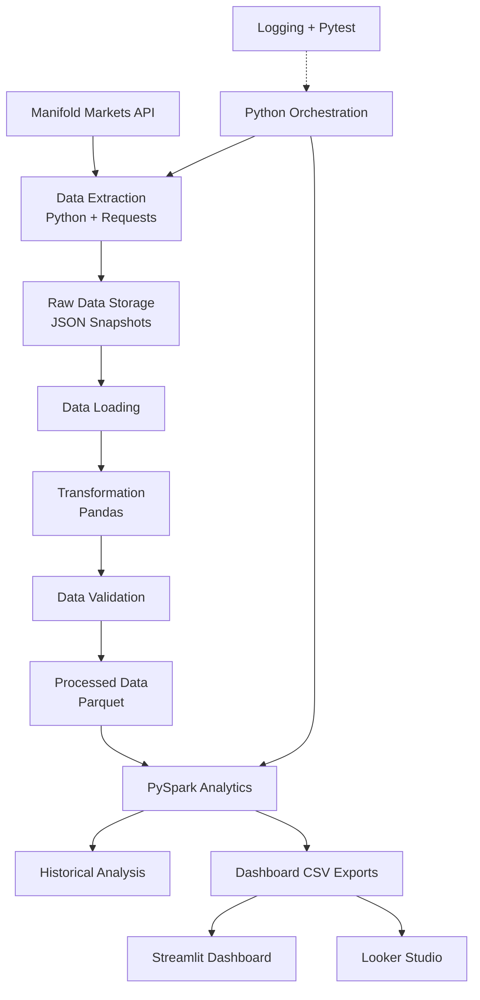

# Prediction Market Data Engineering Platform

An end-to-end Data Engineering project that collects, stores, transforms, and analyzes prediction market data from the Manifold Markets API. The platform uses Python, Pandas, PySpark, and PostgreSQL-independent local storage to build a historical data pipeline and interactive analytics dashboards.

[](https://www.python.org/)
[](https://spark.apache.org/)
[](https://pandas.pydata.org/)
[](https://streamlit.io/)
[](https://pytest.org/)

---

## Project Overview

This project demonstrates how to build a complete batch-oriented data pipeline using publicly available prediction market data.

The pipeline retrieves market information through the Manifold Markets API, stores raw snapshots locally, transforms and validates the data, processes historical records using PySpark, and generates analytical datasets for visualization.

The project also includes a Streamlit dashboard and a Looker Studio report to explore market statistics and historical probability changes.

### Key Objectives

- Build an end-to-end data ingestion pipeline.
- Work with REST APIs and JSON responses.
- Implement a local data lake structure.
- Transform and validate raw datasets.
- Process historical data using PySpark.
- Perform analytical queries and aggregations.
- Build interactive dashboards.
- Implement automated tests and pipeline logging.
- Apply Git version control practices.

---

## Architecture

The platform follows a modular ETL architecture.



### Pipeline Workflow

1. **Extraction:** Retrieve prediction market records from the Manifold Markets API.
2. **Raw Storage:** Save API responses as timestamped JSON snapshots.
3. **Loading:** Read and validate stored JSON data.
4. **Transformation:** Clean, normalize, and prepare data using Pandas.
5. **Data Quality:** Check required fields, missing values, duplicates, and probability ranges.
6. **Processed Storage:** Save transformed datasets in Parquet format.
7. **Analytics:** Use PySpark for aggregations and historical analysis.
8. **Export:** Generate CSV datasets for dashboard consumption.
9. **Visualization:** Present analytical results through Streamlit and Looker Studio.

---

## Technology Stack

| Category | Technologies |
|---|---|
| Programming Language | Python |
| API Integration | REST API, Requests, JSON |
| Data Processing | Pandas, NumPy |
| Big Data Processing | Apache Spark, PySpark |
| Storage Formats | JSON, Parquet, CSV |
| Data Visualization | Streamlit, Looker Studio |
| Testing | Pytest |
| Logging | Python Logging |
| Version Control | Git, GitHub |

---

## Dashboard Preview

### Streamlit Dashboard

The Streamlit dashboard provides an interactive interface for exploring prediction market data.

Features include:

- Key market statistics and KPIs.
- Probability distribution analysis.
- Top markets by trading volume.
- Historical probability changes.
- Market Explorer with filtering and search.
- CSV data downloads.


### Looker Studio Report

The Looker Studio report provides an additional business intelligence view of the processed datasets.

It includes:

- Total market statistics.
- Average probability.
- Average market volume.
- Probability distribution.
- Top markets by volume.


> Add your actual dashboard screenshots to `docs/images/` using the filenames shown above.

---

## Project Structure

```text
prediction-market-data-platform/
│
├── data/
│   ├── raw/
│   │   └── YYYY/MM/
│   │       └── markets_TIMESTAMP.json
│   │
│   ├── processed/
│   │   └── markets_TIMESTAMP.parquet
│   │
│   ├── analytics/
│   │   └── dashboard/
│   │       ├── all_markets.csv
│   │       ├── historical_probability_changes.csv
│   │       ├── market_summary.csv
│   │       ├── probability_distribution.csv
│   │       └── top_markets.csv
│   │
│   └── metadata.csv
│
├── docs/
│   └── images/
│       ├── streamlit-dashboard.png
│       └── looker-studio-dashboard.png
│
├── logs/
│   └── pipeline.log
│
├── src/
│   ├── extraction/
│   │   └── mainfold_api.py
│   │
│   ├── storage/
│   │   └── local_storage.py
│   │
│   ├── transformation/
│   │   └── transform_markets.py
│   │
│   └── processing/
│       └── spark_processor.py
│
├── tests/
│   ├── test_local_storage.py
│   ├── test_mainfold_api.py
│   └── test_transform_markets.py
│
├── main.py
├── streamlit_app.py
├── requirements.txt
├── .gitignore
└── README.md
```

---

## Getting Started

### 1. Clone the Repository

```bash
git clone https://github.com/Ogabek-Qodirov/prediction-market-data-platform.git
```

Navigate into the project directory:

```bash
cd prediction-market-data-platform
```

### 2. Create a Virtual Environment

```bash
python -m venv .venv
```

Activate it on Windows:

```powershell
.venv\Scripts\Activate.ps1
```

### 3. Install Dependencies

```bash
pip install -r requirements.txt
```

Make sure Java is installed and configured if you intend to run the PySpark analytics component.

### 4. Run the Pipeline

```bash
python main.py
```

The main orchestration script executes the following operations:

- Extract market data.
- Save raw API responses.
- Load and validate raw records.
- Transform the data.
- Save processed Parquet files.
- Execute PySpark analytics.
- Export dashboard datasets.

Pipeline logs are written to:

```text
logs/pipeline.log
```

### 5. Run the Streamlit Dashboard

```bash
streamlit run streamlit_app.py
```

Streamlit will start a local web server and provide a URL to access the dashboard.

### 6. Run Automated Tests

```bash
pytest -v
```

**Current test coverage includes:**

- API response validation.
- API extraction behavior.
- Data transformation.
- Handling empty datasets.
- Duplicate records.
- Missing values and invalid probabilities.
- Local JSON and Parquet storage.

Current test result: **21 passing tests**.

---

## Data Quality and Reliability

Data quality is an important part of this platform.

The pipeline implements validation checks to improve data reliability:

- Validates API response structure.
- Checks required market fields.
- Handles missing values.
- Removes duplicate market records.
- Validates probability values between 0 and 1.
- Prevents empty transformed datasets from being saved.
- Checks for missing market IDs and probabilities.
- Monitors records removed during transformation.
- Logs pipeline execution and exceptions.

The pipeline also provides retry handling for API requests.

---

## Historical Data Analysis

Instead of keeping only the latest market state, the platform stores timestamped snapshots.

This makes it possible to analyze how prediction probabilities change over time.

Historical analysis can help answer questions such as:

- Which markets experienced the largest probability changes?
- How do market probabilities evolve over time?
- Which markets have the highest trading volume?
- How does the distribution of market probabilities change?

---

## Future Improvements

Potential future enhancements include:

- Automated scheduled pipeline execution.
- More comprehensive data quality monitoring.
- Incremental data processing.
- Database integration.
- Cloud-based data lake storage.
- CI/CD workflow improvements.
- More advanced historical trend analysis.

These are future development opportunities, not currently implemented features.

---

## What I Learned

Through this project, I gained practical experience with:

- Designing modular ETL pipelines.
- Integrating REST APIs.
- Working with JSON, CSV, and Parquet formats.
- Building a local data lake.
- Processing datasets with Pandas and PySpark.
- Performing historical data analysis.
- Implementing data validation and automated tests.
- Creating interactive analytical dashboards.
- Implementing logging and error handling.
- Managing project development with Git and GitHub.

---

## Author

**Og'abek Qodirov**

Information Systems and Technologies Student  
Aspiring Junior Data Engineer

- GitHub: [Ogabek-Qodirov](https://github.com/Ogabek-Qodirov)
- Project Repository: [Prediction Market Data Platform](https://github.com/Ogabek-Qodirov/prediction-market-data-platform)

---

*This project was developed as part of my Data Engineering learning journey, with a focus on practical ETL development, data processing, historical analytics, and data visualization.*
